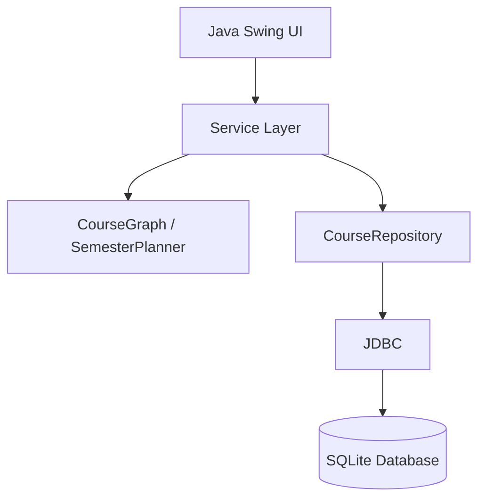
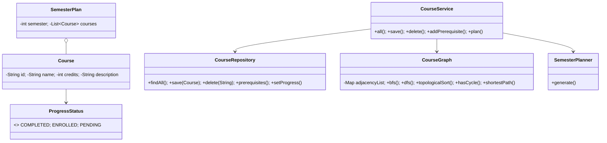
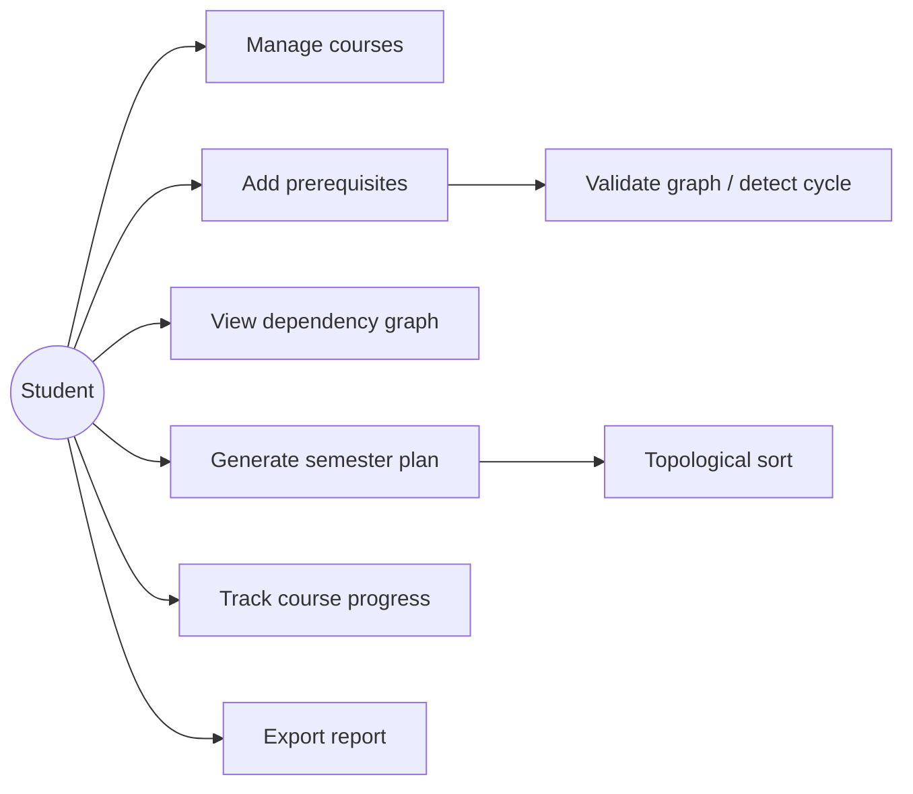
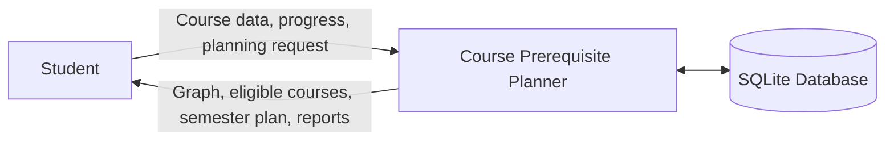
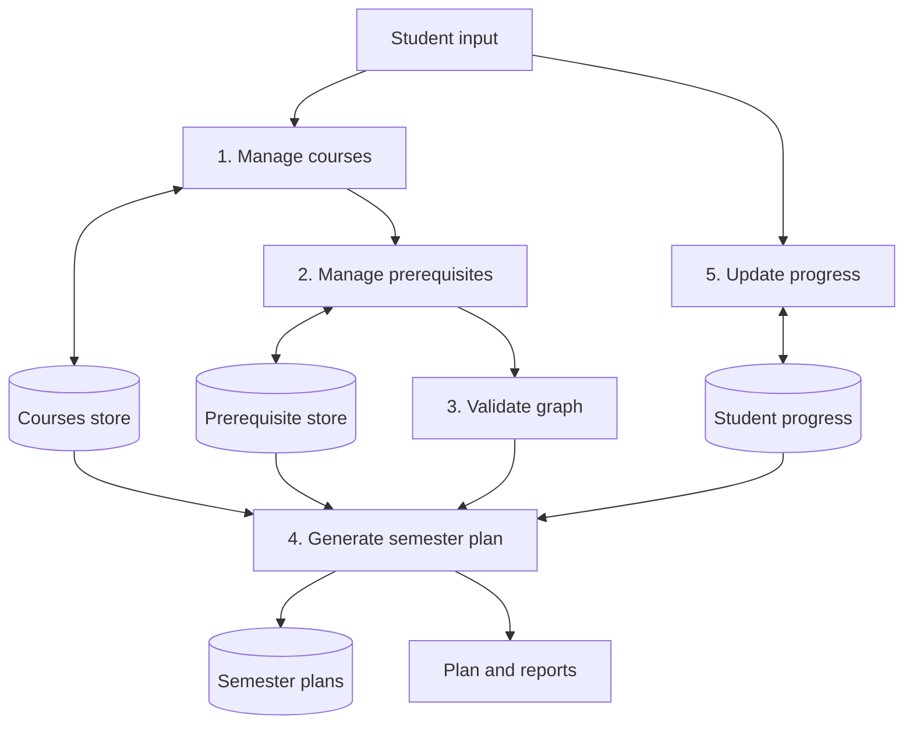
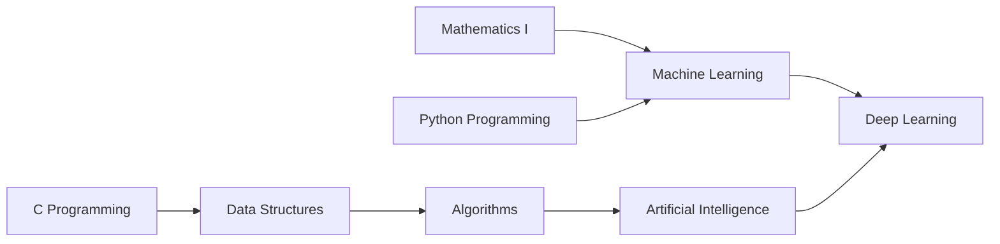

# System diagrams

## 1. System architecture


## 2. UML class diagram


## 3. Use-case diagram


## 4. DFD level 0


## 5. DFD level 1


## 6. ER diagram
```mermaid
erDiagram
  STUDENTS ||--o{ STUDENT_PROGRESS : tracks
  COURSES ||--o{ STUDENT_PROGRESS : has
  COURSES ||--o{ SEMESTER_PLANS : scheduled
  STUDENTS ||--o{ SEMESTER_PLANS : owns
  COURSES ||--o{ PREREQUISITES : dependent_course
  COURSES ||--o{ PREREQUISITES : prerequisite_course
  STUDENTS { int student_id PK; string name }
  COURSES { string course_id PK; string name; int credits; string description }
  PREREQUISITES { string course_id FK; string prerequisite_id FK }
  STUDENT_PROGRESS { int student_id FK; string course_id FK; string status }
  SEMESTER_PLANS { int plan_id PK; int student_id FK; string course_id FK; int semester }
```

## 7. Example dependency graph

